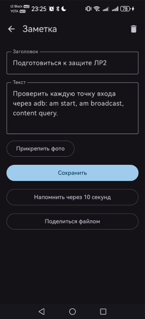
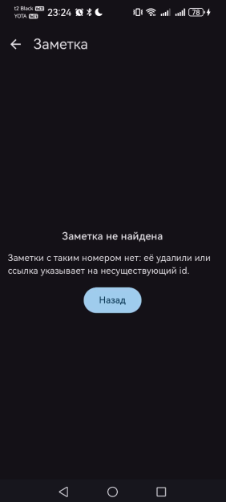
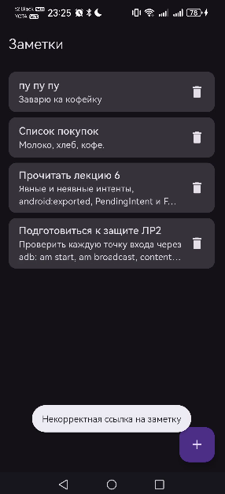
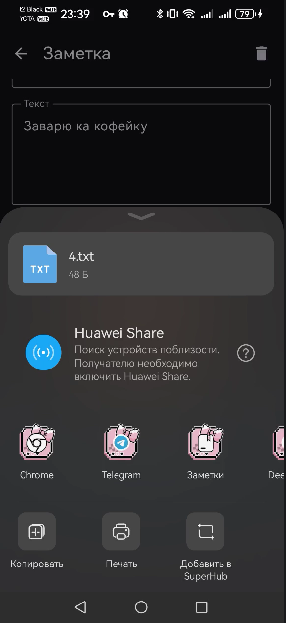
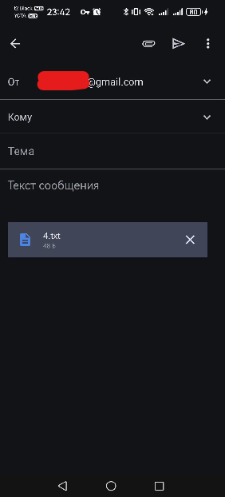
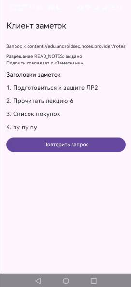
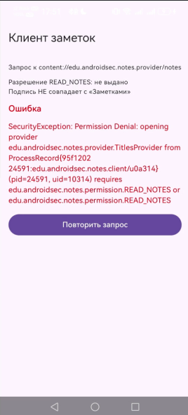

---

# Отчёт по лабораторной работе

Проверка выполнялась на телефоне HUAWEI MLN-LX9, Android 16 (API 36), `adb` из Android SDK.
Сборка: `./gradlew :notes:assembleDebug :client:assembleDebug`.

> **Как читать отчёт.** Строки вида **[СКРИНШОТ N — …]** показывают, где должен быть скриншот.
> Под каждой такой строкой в комментарии лежит готовая строка для вставки картинки
> (``): положите файл в `docs/screenshots/`, раскомментируйте строку
> и удалите строку-подсказку.

## Что сделано

| Пункт | Решение | Изменённые файлы |
|---|---|---|
| ipc-1. Манифест | У каждого компонента в merged-манифесте явно указан `exported`. Экспортированы только `MainActivity` и `TitlesProvider` (под signature-разрешением). Запрошено одно разрешение: `POST_NOTIFICATIONS`. Экспортированный `ProfileInstallReceiver` из `androidx.profileinstaller` (закрыт `android.permission.DUMP`) убран через `tools:node="remove"`: он нужен только для установки профилей прогрева через adb и приложению не нужен. | `notes/src/main/AndroidManifest.xml` |
| ipc-2. Разрешения | `POST_NOTIFICATIONS` запрашивается при нажатии «Напомнить»: сначала пояснение, при первом отказе сообщение, при повторном диалог с переходом в настройки (`ACTION_APP_NOTIFICATION_SETTINGS`). Фото выбирается через `PickVisualMedia` без `READ_MEDIA_IMAGES`, `READ_EXTERNAL_STORAGE` и `CAMERA`. | `notes/src/main/java/edu/androidsec/notes/reminder/ReminderPermission.kt`<br>`notes/src/main/java/edu/androidsec/notes/photo/PhotoPicker.kt` |
| ipc-3. Deep link | Intent-filter VIEW/DEFAULT/BROWSABLE для `notes://note/`. `NoteDeepLink.parse()` принимает только схему `notes`, хост `note` и ровно один сегмент из цифр, помещающийся в положительное `Long`. Несуществующий id даёт экран «Заметка не найдена», некорректный id даёт сообщение, падений нет. | `notes/src/main/AndroidManifest.xml`<br>`notes/src/main/java/edu/androidsec/notes/deeplink/NoteDeepLink.kt`<br>`notes/src/main/java/edu/androidsec/notes/ui/note/NoteViewModel.kt`<br>`notes/src/main/java/edu/androidsec/notes/ui/note/NoteScreen.kt` |
| ipc-4. Уведомление | Оба `PendingIntent` с `FLAG_IMMUTABLE` и явным интентом на свой компонент. `ReminderActionReceiver` объявлен с `exported="false"`. | `notes/src/main/java/edu/androidsec/notes/reminder/ReminderScheduler.kt`<br>`notes/src/main/java/edu/androidsec/notes/reminder/ReminderActionReceiver.kt`<br>`notes/src/main/AndroidManifest.xml` |
| ipc-5. Экспорт файлом | `FileProvider` (`exported="false"`, `grantUriPermissions="true"`) отдаёт один каталог `cache/exports/`. Заметка уходит через `ACTION_SEND` с `content://`-ссылкой и `FLAG_GRANT_READ_URI_PERMISSION`. | `notes/src/main/java/edu/androidsec/notes/share/ShareNote.kt`<br>`notes/src/main/res/xml/file_paths.xml` (новый файл)<br>`notes/src/main/AndroidManifest.xml` |
| ipc-6. Доступ для своих | `<permission>` `READ_NOTES` с `protectionLevel="signature"`. `TitlesProvider` экспортирован и закрыт `android:permission` (это закрывает и чтение, и запись), в коде отдаёт только `/notes` и колонки `_id`, `title`, а `insert`/`update`/`delete` бросают `UnsupportedOperationException`. | `notes/src/main/java/edu/androidsec/notes/provider/TitlesProvider.kt`<br>`notes/src/main/AndroidManifest.xml` |

### Почему `FLAG_IMMUTABLE` и явные интенты

`PendingIntent` отдаётся системе и даёт получателю право действовать от имени приложения.
Без `FLAG_IMMUTABLE` получатель может дописать действие, данные и extras, а неявный интент
можно перенаправить на чужой компонент. Неизменяемый `PendingIntent` с явным компонентом
отправит ровно то, что собрало приложение.

## Результаты `scripts/check.sh`

Запуск по шагам (`bash scripts/check.sh <шаг>`), итоговые строки:

```
=== manifest (шаг 1) ===   ИТОГО: PASS=9 FAIL=0
=== closed   (шаг 2) ===   ИТОГО: PASS=2 FAIL=0
=== deeplink (шаг 4) ===   ИТОГО: PASS=4 FAIL=0
=== provider (шаг 7) ===   ИТОГО: PASS=3 FAIL=0
=== all ===                ИТОГО: PASS=18 FAIL=0
```

**Замечание про шаг `deeplink`.** Проверка падения ищет в logcat и `FATAL EXCEPTION`, и `AndroidRuntime`.
Мой телефон при каждом холодном старте приложения сам пишет в лог безобидные строки
`I AndroidRuntime: RuntimeInit: Starting application from zygote`, поэтому оригинальный скрипт ошибочно
считает такой запуск падением (4 ложных FAIL). Настоящего падения (`FATAL EXCEPTION`) нет.
Поэтому результаты выше получены локальной копией скрипта, где поиск идёт только по `FATAL EXCEPTION`
(оригинал `scripts/check.sh` в репозитории не менялся):

```
bash -c "sed 's/FATAL EXCEPTION|AndroidRuntime/FATAL EXCEPTION/' scripts/check.sh > scripts/out/check_strict.sh"
bash scripts/out/check_strict.sh all
```

(Выводы ниже сокращены: у сообщений `SecurityException` оставлены первые строки, дальше идёт стек вызовов системы.)

## Пункт 3. Deep link

Команды (по очереди для `1`, `999999`, `abc`; для пустого id аналогично с `notes://note/`):

```
adb shell am start -a android.intent.action.VIEW -d notes://note/1
adb shell am start -a android.intent.action.VIEW -d notes://note/999999
adb shell am start -a android.intent.action.VIEW -d notes://note/abc

Starting: Intent { act=android.intent.action.VIEW dat=notes://note/... }
Warning: Activity not started, intent has been delivered to currently running top-most instance.
```

Предупреждение нормальное: приложение уже открыто, а `MainActivity` объявлена с `launchMode="singleTop"`,
поэтому ссылка доставляется в уже работающую Activity (`onNewIntent`), а не создаёт новую.

Результат `check.sh deeplink` (приложение запускается «холодно» для каждой ссылки):

```
PASS  notes://note/1: открыто приложением, падения нет
    | Starting: Intent { act=android.intent.action.VIEW dat=notes://note/... }
    | Status: ok
    | LaunchState: COLD
    | Activity: edu.androidsec.notes/.MainActivity
    | Complete
PASS  notes://note/999999: открыто приложением, падения нет
PASS  notes://note/abc: открыто приложением, падения нет
PASS  notes://note/: открыто приложением, падения нет
```

Что видно на экране:

- `notes://note/1` — открывается заметка 1.
- `notes://note/999999` — экран «Заметка не найдена», редактировать нечего.
- `notes://note/abc` и `notes://note/` — сообщение «Некорректная ссылка на заметку».







## Пункт 4. Уведомление и ресивер «Готово»

Система отправляет broadcast из уведомления явно на наш ресивер (в логе `cmp=...ReminderActionReceiver`),
ресивер срабатывает:

```
adb logcat -d | Select-String "ReminderActionReceiver"

11-16 00:55:43.269  1776  2655 I ActivityManager: SendInner finish:PendingIntentRecord{... edu.androidsec.notes broadcastIntent (allowlist: ...NotificationManagerService)} finalIntent:Intent { act=edu.androidsec.notes.action.DONE flg=0x10000000 ... cmp=edu.androidsec.notes/.reminder.ReminderActionReceiver (has extras) } type:1 callinguid:10111 reslut:0
11-16 00:55:43.269  7873  7873 I ReminderActionReceiver: DONE received for note 1
```


Посторонний вызов (`adb shell am broadcast`) ресивер не получает: ни явный, ни в пакет
(`check.sh closed`):

```
PASS  am broadcast (явный и в пакет): ресивер не вызывался
    | Broadcasting: Intent { act=edu.androidsec.notes.action.DONE flg=0x400000 cmp=edu.androidsec.notes/.reminder.ReminderActionReceiver (has extras) }
    | Broadcast completed: result=0
    | Broadcasting: Intent { act=edu.androidsec.notes.action.DONE flg=0x400000 pkg=edu.androidsec.notes (has extras) }
    | Broadcast completed: result=0
    | <logcat: строк ReminderActionReceiver нет>
```

## Пункт 5. Экспорт заметки файлом

Провайдер не экспортирован, прямое чтение отклоняется:

```
adb shell content read --uri content://edu.androidsec.notes.files/exports/1.txt

Error while accessing provider:edu.androidsec.notes.files
java.lang.SecurityException: Permission Denial: opening provider androidx.core.content.FileProvider from (null) (pid=26939, uid=2000) that is not exported from UID 10240
```

Через «Поделиться файлом» в приложении файл уходит в выбранное приложение по `content://`-ссылке
с временным правом на чтение только этого файла.





## Пункт 6. Провайдер заголовков и signature-разрешение

От имени `adb shell` (uid 2000, разрешения нет) доступ отклонён и для чтения, и для записи:

```
adb shell content query  --uri content://edu.androidsec.notes.provider/notes
Error while accessing provider:edu.androidsec.notes.provider
java.lang.SecurityException: Permission Denial: opening provider edu.androidsec.notes.provider.TitlesProvider from (null) (pid=26950, uid=2000) requires edu.androidsec.notes.permission.READ_NOTES or edu.androidsec.notes.permission.READ_NOTES

adb shell content insert --uri content://edu.androidsec.notes.provider/notes --bind title:s:hacked
Error while accessing provider:edu.androidsec.notes.provider
java.lang.SecurityException: Permission Denial: opening provider edu.androidsec.notes.provider.TitlesProvider from (null) (pid=26962, uid=2000) requires edu.androidsec.notes.permission.READ_NOTES or edu.androidsec.notes.permission.READ_NOTES

adb shell content delete --uri content://edu.androidsec.notes.provider/notes
Error while accessing provider:edu.androidsec.notes.provider
java.lang.SecurityException: Permission Denial: opening provider edu.androidsec.notes.provider.TitlesProvider from (null) (pid=27045, uid=2000) requires edu.androidsec.notes.permission.READ_NOTES or edu.androidsec.notes.permission.READ_NOTES
```

Объявление в merged-манифесте (`check.sh manifest`):

```
| provider|edu.androidsec.notes.provider.TitlesProvider|true|edu.androidsec.notes.permission.READ_NOTES
PASS  edu.androidsec.notes.permission.READ_NOTES объявлено с protectionLevel=signature
PASS  TitlesProvider защищён android:permission=edu.androidsec.notes.permission.READ_NOTES
```

### Клиент с той же подписью

`:client`, собранный и запущенный из Android Studio (подписывается тем же debug-ключом, что и `:notes`),
получает разрешение `READ_NOTES` и видит заголовки заметок.



### Клиент с другим ключом

Код менять не нужно: `client/build.gradle.kts` принимает параметры подписи через `-P` (или через
`client/signing.properties`). Ключ `other.jks` и `signing.properties` в `.gitignore`, в репозиторий не попадают.

```
keytool -genkeypair -keystore other.jks -storepass other123 -keypass other123 -alias other -keyalg RSA -keysize 2048 -validity 10000 -dname "CN=Other, O=Test, C=RU"

.\gradlew.bat :client:assembleDebug "-Psigning.storeFile=E:/lab2-notes/other.jks" "-Psigning.storePassword=other123" "-Psigning.keyAlias=other" "-Psigning.keyPassword=other123"
BUILD SUCCESSFUL in 6s

adb install client\build\outputs\apk\debug\client-debug.apk
Performing Streamed Install
Success
```

Клиент установлен с другой подписью, поэтому система не выдаёт ему `READ_NOTES` (`protectionLevel="signature"`),
и обращение к провайдеру завершается `SecurityException`.


