# Лабораторная работа №3. Пользовательский ввод и защита интерфейса

Доработка приложения «Заметки» (ветка `lab3`, основана на моей ЛР2 из ветки `solution`).
Проверка выполнялась на телефоне HUAWEI MLN-LX9, Android 16 (API 36).

## Что сделано

| Пункт | Решение | Основные файлы |
|---|---|---|
| Поля ввода | Заголовок, текст и новое поле «Теги» переведены на `TextFieldState`. Ограничения задаёт `InputTransformation` по принципу белого списка: при нарушении правила изменение откатывается целиком (`revertAllChanges`), а не «исправляется». Под полем показывается причина отказа, а пока ошибки нет, то счётчик символов или подсказка. | `ui/note/ValidatedField.kt` `ui/note/NoteScreen.kt` `ui/note/NoteViewModel.kt` |
| Проверка в репозитории | Правила вынесены в `NoteRules` (заголовок до 100 символов в одну строку, текст до 5000, до 5 тегов по 1–20 символов из `a-z`, `0-9`, `-`). `RoomNotesRepository.save()` проверяет их ещё раз и бросает `InvalidNoteException`, поэтому некорректная заметка в базу не попадает, даже если обойти экран. Теги нормализуются (лишние пробелы убираются). | `domain/NoteRules.kt` `data/NotesRepository.kt` |
| Миграция базы | В `Note` и `NoteEntity` добавлены `tags` и `isSecret`. Версия Room 1 → 2, `MIGRATION_1_2` добавляет две колонки через `ALTER TABLE ... ADD COLUMN ... NOT NULL DEFAULT`. Старые заметки сохраняются (пустые теги, «не секретная»). `fallbackToDestructiveMigration` не используется. | `data/db/NotesDatabase.kt` `data/db/NoteEntity.kt` `domain/Note.kt` |
| Поиск и сортировка | Новый экран поиска, открывается иконкой лупы в списке. Поиск по заголовку и тексту, сортировка: по заголовку, сначала новые, сначала старые. Символы `%`, `_` и `\` ищутся буквально: `LIKE :pattern ESCAPE '\'`, строка экранируется `escapeForLike()` и передаётся параметром. Сортировка берётся из `enum NoteSort`, каждому значению соответствует свой готовый запрос в `NoteDao`. `@RawQuery` и подстановки имени колонки нет. | `ui/search/*` `data/db/NoteDao.kt` `data/LikeEscape.kt` `domain/NoteSort.kt` |
| Удаление с отменой | Удаление из списка и с экрана заметки только прячет заметку и показывает снекбар «Заметка удалена» с кнопкой «Отменить». Из базы заметка удаляется через 5 секунд (`PendingDeletions`), после этого отменяется напоминание. «Отменить» возвращает заметку целиком. | `data/PendingDeletions.kt` `ui/list/*` `ui/note/NoteViewModel.kt` `di/AppContainer.kt` |
| Секретные заметки | Переключатель «Секретная заметка». Пока заметка открыта, окно защищено `FLAG_SECURE` (нет скриншотов и записи экрана, в «Недавних» пустая карточка), у обычных заметок флаг снимается. В списке и в результатах поиска у секретной заметки только заголовок и замок. «Копировать текст» помечает буфер обмена как чувствительный (`EXTRA_IS_SENSITIVE`). В напоминании вместо заголовка секретной заметки текст «Секретная заметка». | `ui/note/SecretNoteSupport.kt` `ui/note/NoteScreen.kt` `ui/list/NotesListScreen.kt` `reminder/ReminderScheduler.kt` |

(Пути даны относительно `notes/src/main/java/edu/androidsec/notes/`.)

## Тесты

| Набор | Что проверяет | Запуск |
|---|---|---|
| `NoteRulesTest` (23, JVM) | допустимые значения, превышение длины, неверные символы, неверный тег, слишком много тегов, нормализация | `./gradlew :notes:testDebugUnitTest` |
| `LikeEscapeTest` (7, JVM) | экранирование `%`, `_`, `\`; порядок замен | то же |
| `PendingDeletionsTest` (8, JVM) | заметка скрыта сразу, удаляется только после задержки, отмена, повторное удаление, независимость заметок | то же |
| `NotesRepositoryValidationTest` (11, Room) | некорректная заметка (заголовок, текст, теги) не попадает в базу; неудачная правка не затирает сохранённую заметку | `./gradlew :notes:connectedDebugAndroidTest` |
| `NotesMigrationTest` (2, Room) | база версии 1 с двумя заметками открывается версией 2: заметки на месте, `tags = ""`, `isSecret = false` | то же |
| `NoteSearchTest` (15, Room) | поиск по заголовку и тексту, `%` `_` `\` буквально, ввод вроде `' OR 1=1 --`, три сортировки | то же |

## Проверка на телефоне

### 1. Поля ввода

101 символ в заголовке, перенос строки в заголовке, теги `Kotlin`, `a_b` и шесть тегов отклоняются, под полем видна причина.

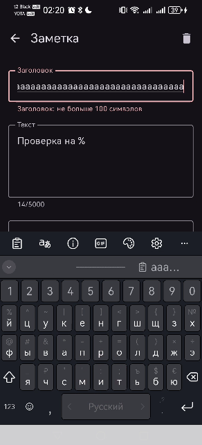

*Скриншот: экран заметки, под полем показана ошибка.*

### 2. Тесты

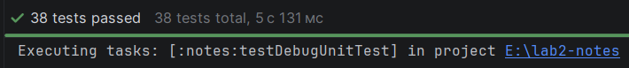

*Скриншот: окно Run с полностью пройденными тестами.*

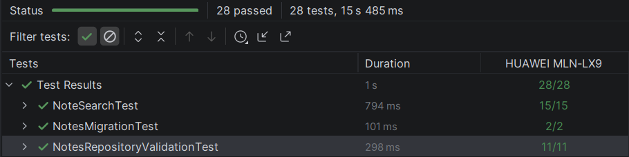

*Скриншот: окно Run с зелёными `NotesRepositoryValidationTest`, `NotesMigrationTest`, `NoteSearchTest`.*

### 3. Миграция

Покрыта `NotesMigrationTest`; на телефоне новая заметка с тегами создаётся, теги сохраняются после перезапуска.

https://github.com/user-attachments/assets/f5e9cbab-6133-4ada-b983-51509ad9e43b

*Запись экрана: заметка с тегами после повторного открытия.*

### 4. Поиск и сортировка

`%`, `_` и `\` находят только заметки с этими символами; работают три варианта сортировки.

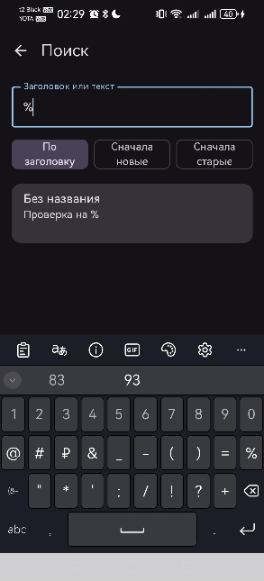

*Скриншот: экран поиска, в строке `%`, в результатах только заметка с этим символом.*

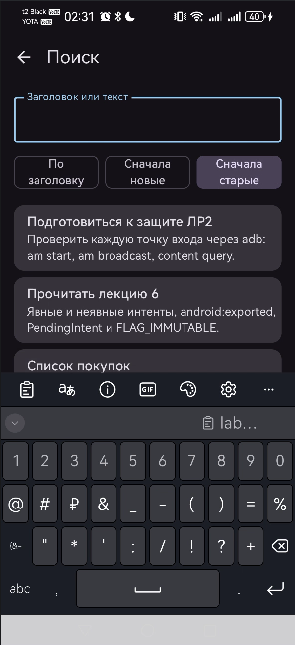

*Скриншот: экран поиска с выбранной сортировкой.*

### 5. Удаление с отменой

«Отменить» возвращает заметку; без отмены заметка исчезает через 5 секунд; при закрытии приложения в эти секунды заметка остаётся на месте.

https://github.com/user-attachments/assets/8ebd912f-eb4b-4590-a69d-0512c66bc632

*Запись экрана: список со снекбаром «Заметка удалена» и кнопкой «Отменить».*

### 6. Секретные заметки

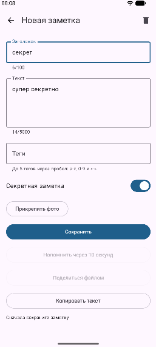

*Скриншот: экран заметки с включённым переключателем «Секретная заметка».*

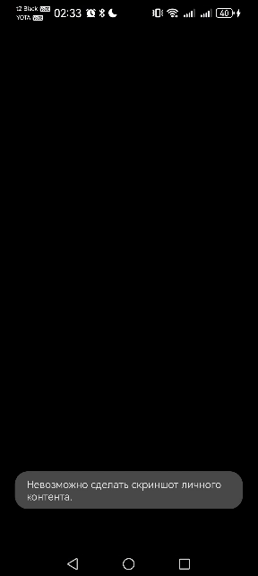

*Скриншот: сообщение системы о том, что снимок экрана запрещён политикой безопасности.*

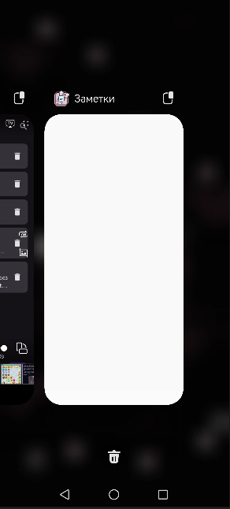

*Скриншот: «Недавние» с пустой карточкой приложения при открытой секретной заметке.*

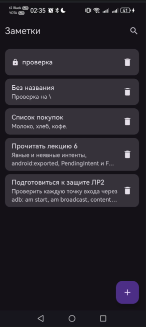

*Скриншот: список заметок, у секретной только заголовок и замок.*

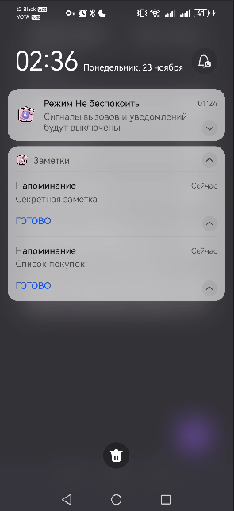

*Скриншот: уведомление-напоминание с текстом «Секретная заметка» вместо заголовка.*

### 7. Буфер обмена

Метка `EXTRA_IS_SENSITIVE` выставляется при каждом копировании секретной заметки. Проверка не зависит от оформления системы: сразу после `setPrimaryClip` приложение читает метку из буфера обратно и пишет в Logcat (тег `SecretNote`, текст заметки в лог не попадает). У секретной заметки в буфере `flag stored in clipboard=true`, у обычной `false`.

Скрытие превью в системной плашке буфера обмена визуально проверить не удалось: на эмуляторе Android 16 плашка не появляется вовсе, а на телефоне HUAWEI её рисует оболочка производителя. В штатном Android 13+ эту метку использует система.

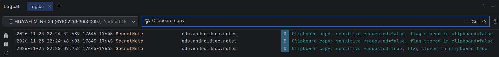

*Скриншот: Logcat с фильтром `Clipboard copy`: две обычные заметки (`false`) и одна секретная (`true`).*

## Известные ограничения

- `LIKE` и `COLLATE NOCASE` в SQLite не учитывают регистр только для латиницы: «банан» не найдёт «Банан».
- Поиск идёт и по тексту секретных заметок, значит, по результатам можно угадывать содержимое, хотя сам текст в результатах не показывается. Теги в поиске не участвуют.
- Заголовок для напоминания выбирается в момент нажатия «Напомнить»: если после этого сделать заметку секретной, уже запланированное уведомление покажет старый заголовок.
- Если удалить две заметки подряд, снекбар переключается на вторую, и у первой «Отменить» пропадает раньше, чем истекут её 5 секунд.
- Экспорт файлом (`ShareNote`) из ЛР2 по-прежнему отдаёт секретную заметку целиком: пункт задания его не затрагивал.
